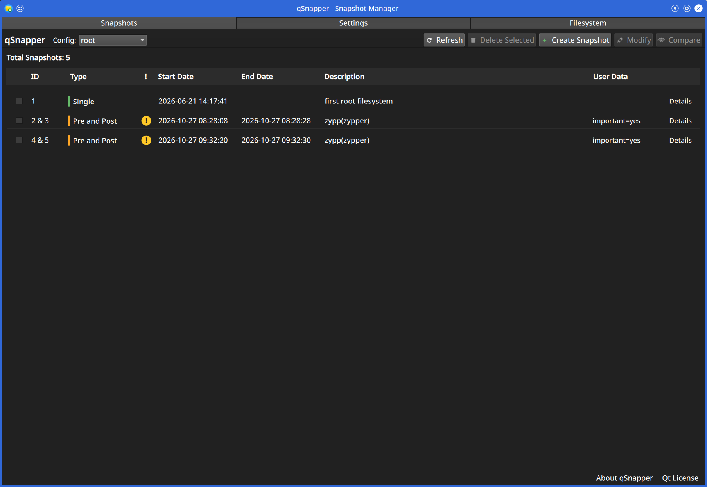
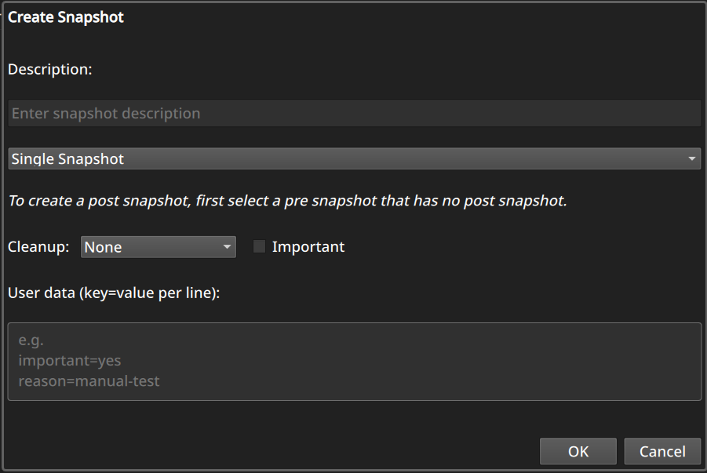
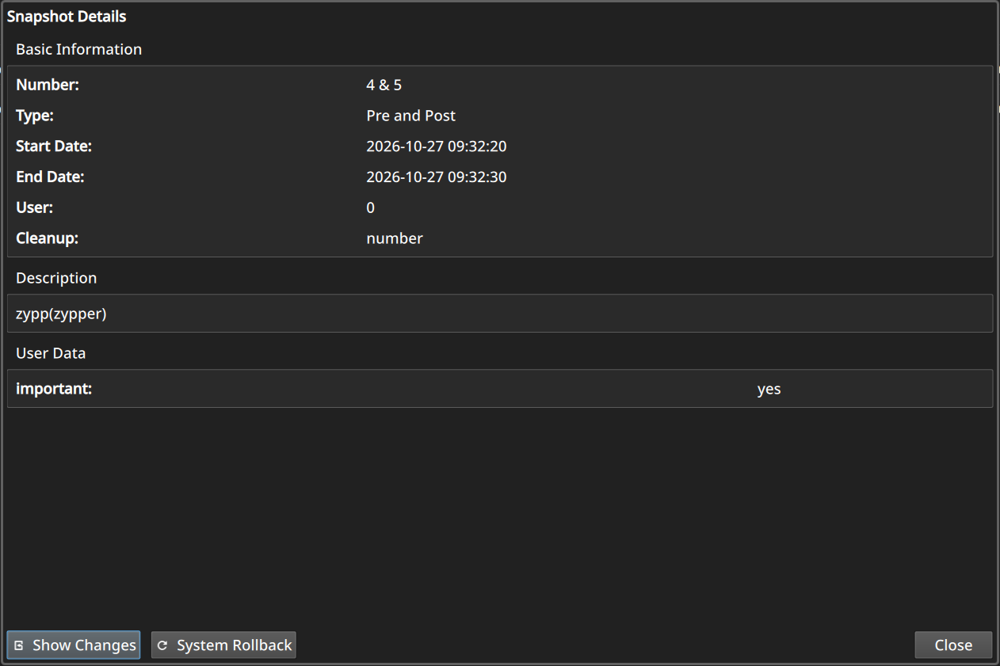
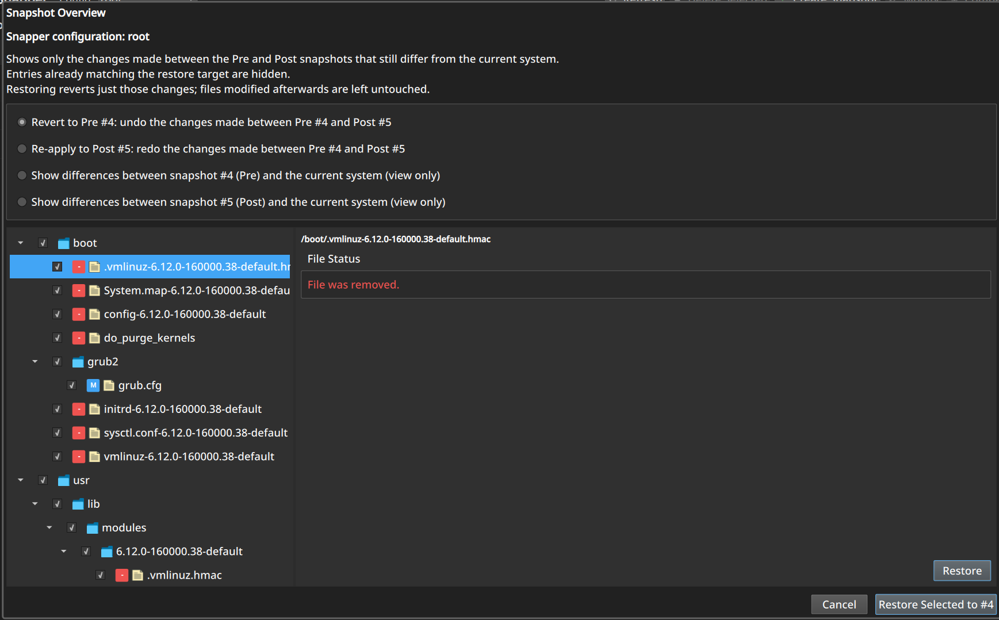
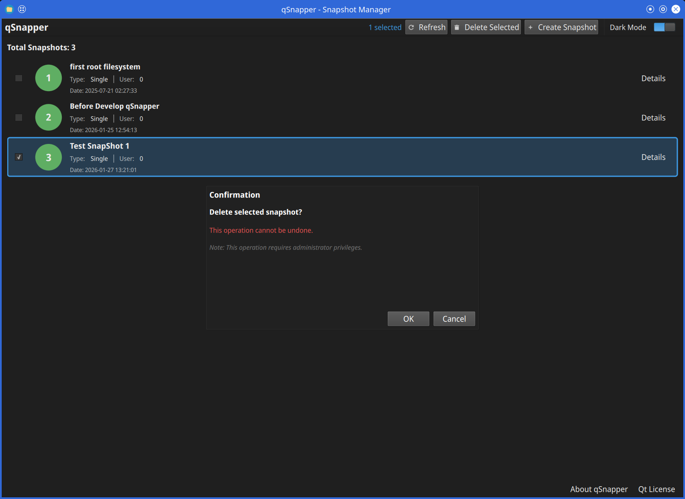
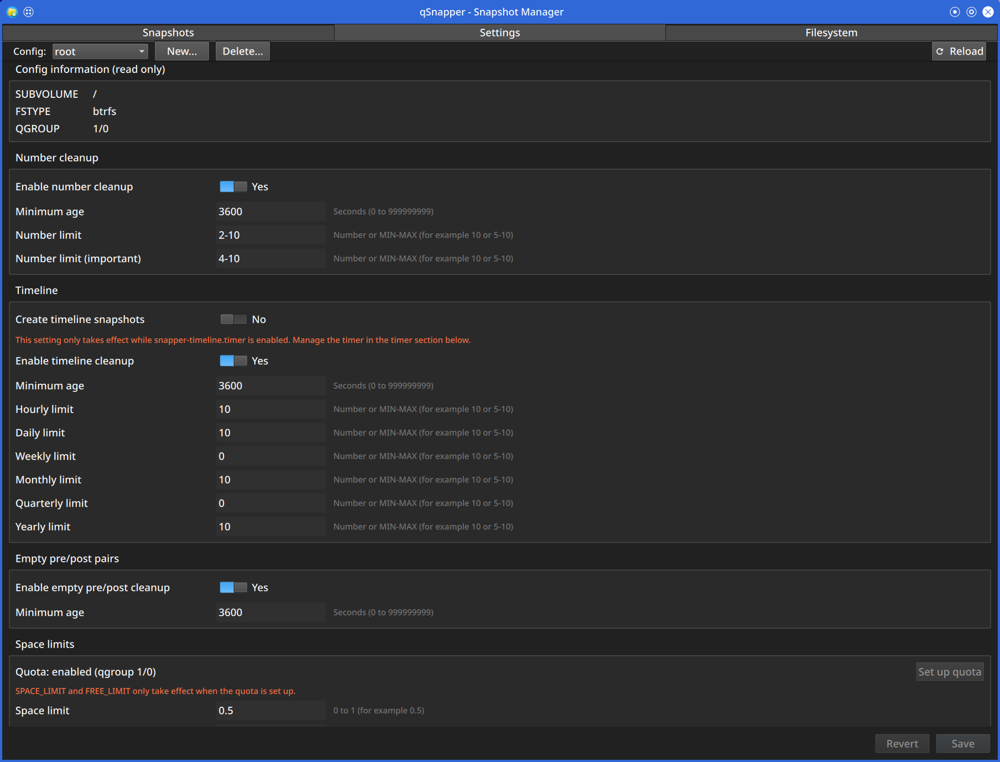
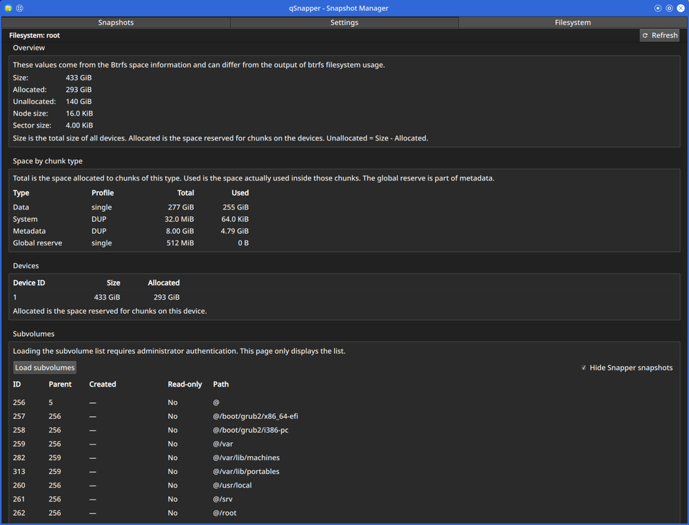

# qSnapper

A modern Qt6/QML GUI application for managing Btrfs/Snapper filesystem snapshots on Linux.

  
  

## Overview

qSnapper is a graphical user interface for the Snapper snapshot management tool. It provides an intuitive way to create, browse, and manage filesystem snapshots on Btrfs and other supported filesystems.

### Features

- **Snapshot Management**:  
  Create, view, compare, and delete filesystem snapshots, including multi-select deletion that authenticates once and reports any snapshot that could not be deleted  
- **Snapshot Types**:  
  Support for Single, Pre, and Post snapshots  
- **Cleanup Policies**:  
  Choose Number or Timeline cleanup when creating a snapshot; snapshots marked as important are counted against a separate number limit  
- **Snapshot Settings**:  
  Edit the selected configuration's cleanup and timeline limits, space limits, and background comparison settings  
- **Configuration Management**:  
  Create a Snapper configuration for a mounted Btrfs subvolume and delete a configuration with typed-name confirmation  
- **Systemd Timers**:  
  Inspect the snapper timers and enable or disable them from the Settings tab  
- **Filesystem Overview**:  
  Read-only Btrfs allocation and usage per chunk type and per device, plus an on-demand subvolume list  
- **File Comparison**:
  View changes between snapshots with detailed diff preview
- **Pre/Post Snapshot Comparison**:
  Choose between reverting to the Pre snapshot, re-applying to the Post snapshot, or viewing either snapshot against the current system. Restoring only touches files that changed between Pre and Post
- **Restore Preview**:
  Preview files before restoring from snapshots
- **Fast Restore**:
  Two restore modes — Direct Copy (fast, btrfs reflink-aware) and YaST compatible — with configurable batch size and real-time progress logging
- **Theme Support**:  
  Light or Dark mode, or follow the system theme  
- **Internationalization**:
  Multi-language support (English, Japanese, German)
- **Modern UI**:  
  Built with Qt6 Quick/QML for a responsive user experience  
- **Secure Operations**:  
  Uses D-Bus and PolicyKit for privilege escalation  

## Screenshots

### Main Window - Snapshot List

The main window has three tabs: Snapshots, Settings, and Filesystem. The Snapshots tab displays all available snapshots with detailed information including snapshot number, type, important marker, timestamps, description, and user data.  

  

### Create Snapshot Dialog

Create new snapshots with customizable options including snapshot type (Single/Pre/Post),  
description, cleanup algorithm, important flag, and user data.  

  

### Snapshot Detail Dialog

View detailed information about a specific snapshot,  
including file changes, metadata, and available actions.  

  

### Restore Preview Dialog

Preview file changes before restoring from a snapshot.  
This helps you understand what will be modified.  

### Restore Options Dialog

Choose the restore method (Direct Copy or YaST compatible) and the batch size in the Restore Options dialog while restoring files.  

### Delete Snapshot Dialog

Confirm snapshot deletion with a safety dialog that warns the operation cannot be undone and notes that administrator privileges are required. A multi-selection is summarized by count.  

### Settings Tab

Edit the selected Snapper configuration's cleanup limits, space limits, and background comparison settings.  
You can also enable or disable the snapper systemd timers, create or delete configurations, and choose the theme.  

### Filesystem Tab

View read-only Btrfs allocation and usage per chunk type and per device,  
and load the subvolume list on demand.  

## Documentation

| Document | Contents |
|----------|----------|
| [Installation](docs/INSTALL.md) | Runtime and build dependencies, building from source, build options, and post-installation steps |
| [Usage](docs/USAGE.md) | Creating, viewing, deleting, comparing, and restoring snapshots; Settings and Filesystem tabs; configuration |
| [Troubleshooting](docs/TROUBLESHOOTING.md) | D-Bus connection errors, permission errors, and missing Snapper configurations |
| [Development](docs/DEVELOPMENT.md) | Development build and project structure |

## Contributing

Contributions are welcome! Please feel free to submit issues and pull requests.  

### Guidelines

1. Follow the existing code style
2. Test your changes thoroughly
3. Update documentation as needed
4. Ensure all commits are signed

## License

This project is licensed under the GNU General Public License v2.0 or later - see the [LICENSE.md](LICENSE.md) file for details.  

## Acknowledgments

- [Snapper](http://snapper.io/) - The snapshot management tool
- [Qt Project](https://www.qt.io/) - The cross-platform framework
- [PolicyKit](https://www.freedesktop.org/software/polkit/) - Authorization framework

## Links

- GitHub Repository: https://github.com/presire/qSnapper
- Issue Tracker: https://github.com/presire/qSnapper/issues
- Snapper Documentation: http://snapper.io/documentation.html

## Author

**Presire**  
- GitHub: [@presire](https://github.com/presire)
