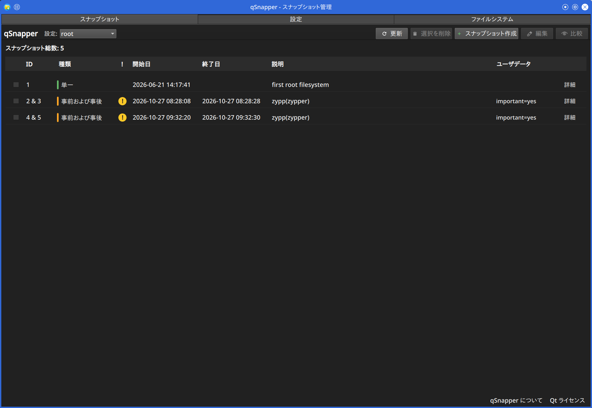
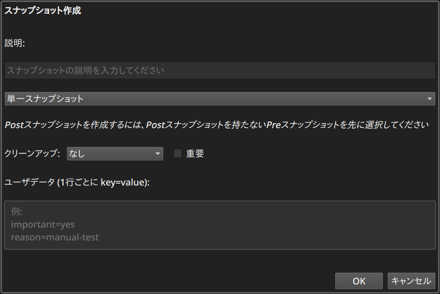
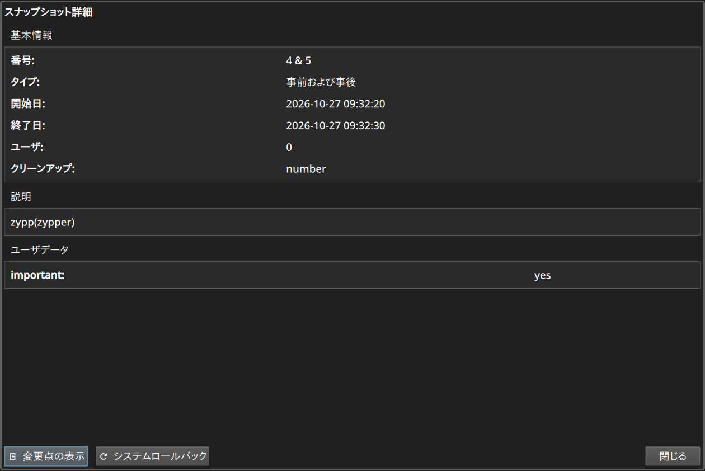
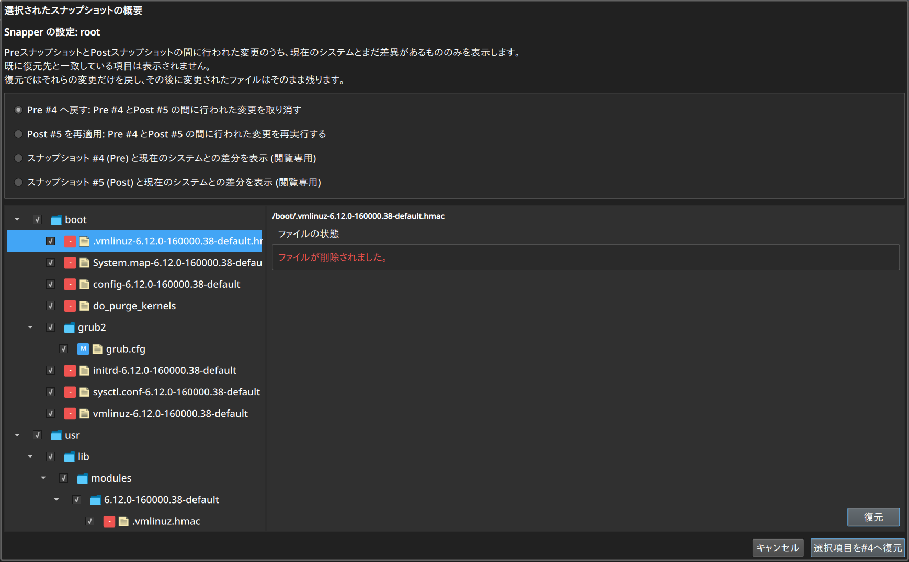
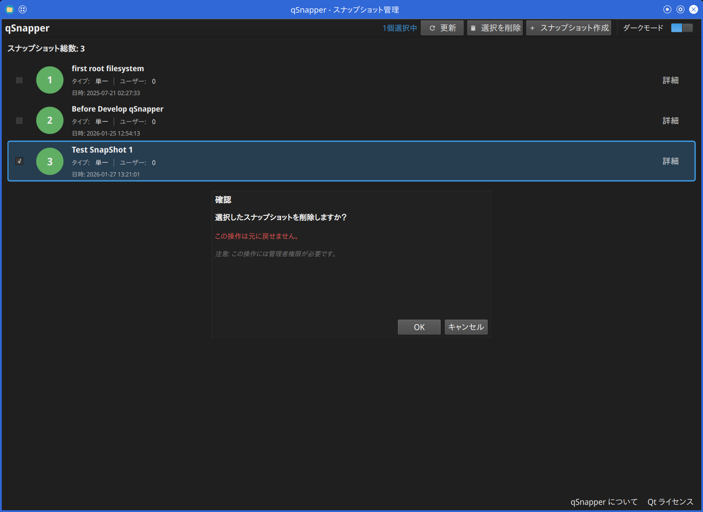
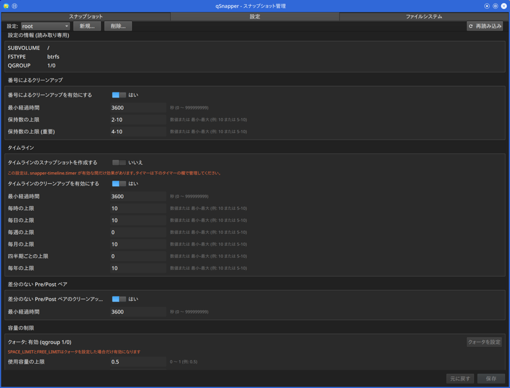
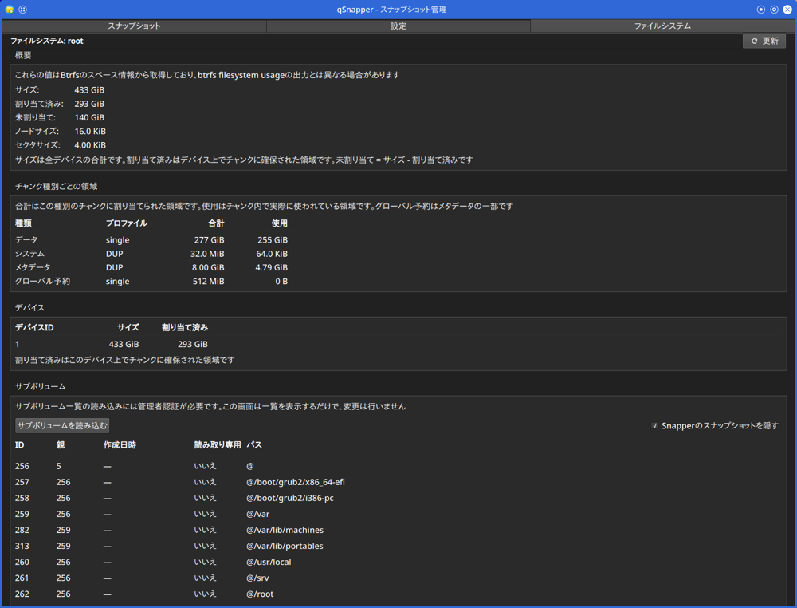

# qSnapper

Linux向けのBtrfs/Snapperファイルシステムスナップショットを管理するモダンなQt6/QML GUIアプリケーションです。  

  
  
  

  
  

## 概要

qSnapperは、Snapperスナップショット管理ツールのグラフィカルユーザインターフェースです。  
Btrfsやその他のサポートされているファイルシステム上でファイルシステムスナップショットを作成、閲覧、管理するための直感的な方法を提供します。  

### 機能

- **スナップショット管理**:  
  ファイルシステムスナップショットの作成、表示、比較、削除。複数選択による一括削除は1回の認証で実行し、削除できなかったスナップショットを報告  
- **スナップショットタイプ**:  
  Single、Pre、Postスナップショットをサポート  
- **クリーンアップポリシー**:  
  スナップショット作成時にNumberまたはTimelineを選択可能。重要スナップショットは専用のNumber上限で数える  
- **スナップショット設定**:  
  選択中の設定のクリーンアップ上限、タイムライン上限、容量上限、バックグラウンド比較を編集  
- **設定管理**:  
  マウント済みのBtrfsサブボリュームに対するSnapper設定の作成と、名前入力による確認付きの設定削除  
- **systemdタイマ**:  
  snapperのタイマ状態を表示し、設定タブから有効化 / 無効化  
- **ファイルシステム情報**:  
  Btrfsのチャンクタイプ別 / デバイス別の割り当てと使用量、および要求時に読み込むサブボリューム一覧を読み取り専用で表示  
- **ファイル比較**:
  スナップショット間の変更を詳細なdiffプレビューで表示
- **Pre/Postスナップショット比較**:
  Preスナップショットへの復元、Postスナップショットの再適用、および各スナップショットと現在のシステムの差分表示を切り替え可能。復元はPreとPostの間で変更されたファイルのみに影響
- **復元プレビュー**:
  スナップショットから復元する前にファイルをプレビュー
- **高速復元**:
  2つの復元モード — Direct Copy (高速、btrfs reflink対応)とYaST互換 — を搭載し、バッチサイズ設定とリアルタイム進捗ログを提供
- **テーマサポート**:  
  ライト / ダークモードの切り替え、およびシステムテーマへの追従  
- **国際化対応**:
  多言語サポート (英語、日本語、ドイツ語)
- **安全な操作**:  
  D-BusとPolicyKitを使用した権限昇格  

## スクリーンショット

### メインウィンドウ - スナップショット一覧

メインウィンドウにはスナップショット、設定、ファイルシステムの3つのタブがあります。スナップショットタブには、すべての利用可能なスナップショットがスナップショット番号、タイプ、重要マーク、開始 / 終了日時、説明、ユーザデータなどの詳細情報とともに表示されます。  

### スナップショット作成ダイアログ

スナップショットタイプ (Single/Pre/Post)、説明、クリーンアップアルゴリズム、重要フラグ、ユーザデータなど、  
カスタマイズ可能なオプションで新しいスナップショットを作成できます。  

### スナップショット詳細ダイアログ

特定のスナップショットの詳細情報 (ファイル変更、メタデータ、利用可能なアクションなど)を表示します。  

### 復元プレビューダイアログ

スナップショットから復元する前にファイル変更をプレビューします。  
これにより、何が変更されるかを理解できます。  

### 復元オプションダイアログ

復元時に、復元方式 (ダイレクトコピー / YaST互換) とバッチサイズを復元オプションダイアログで設定できます。  

### スナップショット削除ダイアログ

削除されるスナップショットを確認する安全確認ダイアログでスナップショットの削除を確認します。操作が取り消せないことと管理者権限が必要なことを表示し、複数選択時は件数を示します。  

  

### 設定タブ

選択中のSnapper設定のクリーンアップ上限、容量上限、バックグラウンド比較の設定を編集できます。  
また、snapperのsystemdタイマの有効化 / 無効化、設定の作成 / 削除、テーマの選択も行えます。  

### ファイルシステムタブ

チャンクタイプ別・デバイス別のBtrfsの割り当て状況と使用量を読み取り専用で表示し、  
サブボリューム一覧を必要に応じて読み込めます。  

## ドキュメント

| ドキュメント | 内容 |
|--------------|------|
| [インストール](docs/INSTALL_JP.md) | 実行時 / ビルド依存関係、ソースからのビルド、ビルドオプション、インストール後の手順 |
| [使用方法](docs/USAGE_JP.md) | スナップショットの作成・表示・削除・比較・復元、設定タブとファイルシステムタブ、各種設定 |
| [トラブルシューティング](docs/TROUBLESHOOTING_JP.md) | D-Bus接続エラー、権限拒否エラー、Snapperが設定されていない場合の対処 |
| [開発](docs/DEVELOPMENT_JP.md) | 開発用ビルドとプロジェクト構造 |

## コントリビューション

コントリビューションを歓迎します！  
Issueやプルリクエストを自由に提出してください。  

### ガイドライン

1. 既存のコードスタイルに従う  
2. 変更を徹底的にテストする  
3. 必要に応じてドキュメントを更新する  
4. すべてのコミットに署名する  

## ライセンス

このプロジェクトはGNU General Public License v2.0以降の下でライセンスされています。  
詳細については[LICENSE.md](LICENSE.md)ファイルを参照してください。  

## 謝辞

- [Snapper](http://snapper.io/) - スナップショット管理ツール
- [Qt Project](https://www.qt.io/) - クロスプラットフォームフレームワーク
- [PolicyKit](https://www.freedesktop.org/software/polkit/) - 認可フレームワーク

## リンク

- GitHubリポジトリ: https://github.com/presire/qSnapper
- イシュートラッカー: https://github.com/presire/qSnapper/issues
- Snapperドキュメント: http://snapper.io/documentation.html

## 作者

**Presire**  
- GitHub: [@presire](https://github.com/presire)  
